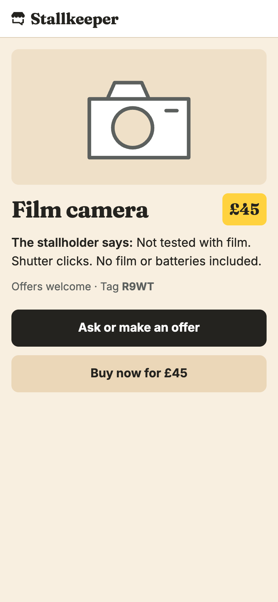
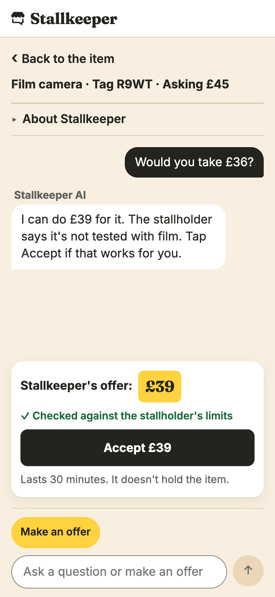
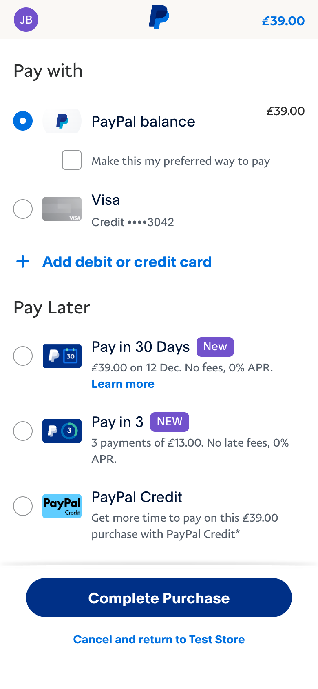
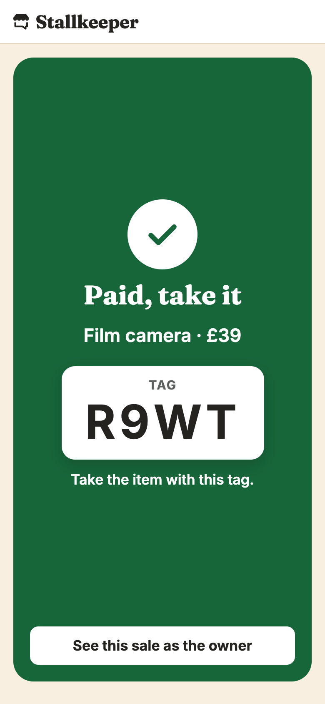
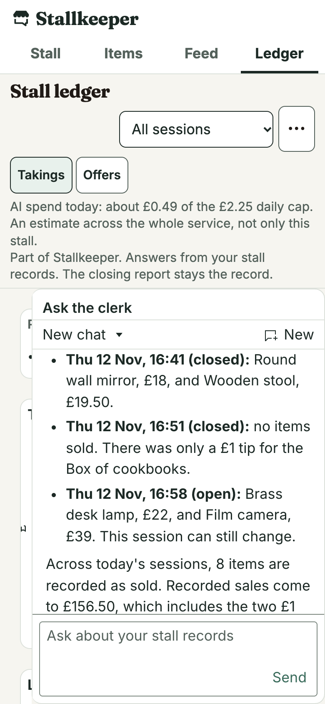
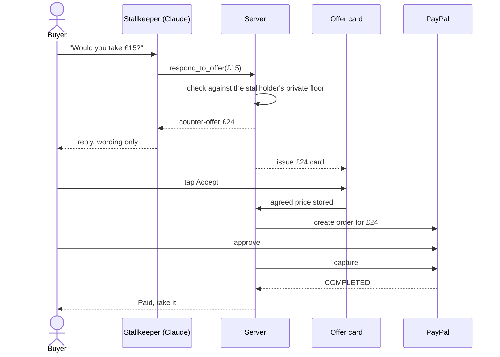

# Stallkeeper

[](https://github.com/tonybatty/stallkeeper/actions/workflows/check.yml)


<table>
  <tr>
    <td align="center"></td>
    <td align="center"></td>
    <td align="center"></td>
    <td align="center"></td>
    <td align="center"></td>
  </tr>
  <tr>
    <td align="center">1. Item page from the tag</td>
    <td align="center">2. Chat and the server's offer card</td>
    <td align="center">3. PayPal sandbox approval</td>
    <td align="center">4. "Paid, take it" after the capture</td>
    <td align="center">5. Stall ledger and Stall clerk</td>
  </tr>
</table>

**Leave a stall open while you get on with your day.** A buyer at your second-hand stall scans an item's printed tag, asks an AI about it, agrees a price within your limits and pays with PayPal. At closing, review payments and flag missing unsold items.

**[Try the demo](https://stallkeeper.onrender.com/demo)** in the PayPal sandbox, on a seeded demo stall. You install nothing, need no Stallkeeper account, and no real money moves.

**Hosted sandbox evidence.** 21 item sales and one tip were captured, and all 22 orders agreed with PayPal's records. [Read the evidence](docs/EVIDENCE.md#ledger-wide-paypal-check-on-the-hosted-service-7-november-2026) · [What has run](#what-has-run)

Jump to [sponsor tools](#paypal-and-sponsor-integrations) · [run locally](#run-locally) · [how an offer becomes a payment](#how-an-offer-becomes-a-payment) · [how the AI works](#how-the-ai-works)

## Try it in three steps

Start at **[stallkeeper.onrender.com/demo](https://stallkeeper.onrender.com/demo)**, the judge page for the seeded demo stall. Tag codes change at every reset, so always start there, never from a saved item link. The PayPal sandbox buyer login and the demo owner password are published on that page.

1. Press Be a buyer, then Ask or make an offer. Ask about the item, offer less than the asking price, then tap Accept on the offer card.
2. Pay with the PayPal sandbox buyer login. It is on the `/demo` page under "PayPal login for buyers", and folded under the PayPal button with Copy buttons. Wait for "Paid, take it".
3. Press See this sale as the owner on the paid screen, then Be the owner. Find the sale on the live feed and press Close stall, which opens the closing report. Then open the Ledger tab and ask the Stall clerk, "Please check every payment with PayPal and tell me if any differ." On a phone, open the ⋯ menu at the top of the ledger and choose Ask the clerk. Finish by opening the Stall tab and pressing Open stall, so the next visitor finds the stall open.

The demo stall is shared, so another visitor may have closed or reset it before you. If chat is unavailable, pay the asking price. If the clerk is unavailable, open the ⋯ menu at the top of the ledger, choose PayPal check and press Check with PayPal. Closing takes up to about half a minute. If the tab still says Closing, open it again a few seconds later, because it does not refresh by itself. The fuller path is in the [demo walkthrough](#demo-walkthrough).

You need no personal API key and no live PayPal account. Never use a live PayPal account with this prototype. No real money moves, because every payment runs in the PayPal sandbox.

## Film and Devpost

- Film: https://youtu.be/dHdn7jRRluQ
- Devpost: https://devpost.com/software/stallkeeper

The film is an illustrated explainer. It combines illustration drawn in code with real app recordings against PayPal sandbox services, and has synthetic narration. The people and demonstration stock are fictional. It shows seeded demonstration data, and the phone camera views in it are mocked. The recordings ran the app locally, and the hosted demo is linked above.

## The problem

Stallkeeper is for people selling one-off second-hand goods from a self-service stall, such as a table in the front garden, while they are nearby but busy. A payment QR code can take money, but it cannot say whether the lamp works or whether the stallholder would take £15. With second-hand goods, those questions are often the sale.

The buyer is a person standing at the stall with a phone, not an AI agent. They install nothing and need no Stallkeeper account.

More on the setting is under [Who it is for](#who-it-is-for).

## PayPal and sponsor integrations

Claude has five jobs. It answers buyers from the stallholder's notes, words the replies to offers, proposes late price cuts, summarises the closing report and answers the stallholder's questions as the Stall clerk. It never decides a price alone. The server works out every counter-offer and never agrees a price below the floor the stallholder set, and a price is agreed only when the buyer taps the offer card the server issued.

PayPal OAuth 2.0, Orders v2 and the JavaScript SDK v6 take the payment, and Webhooks v1 checks the signature of every event PayPal sends. The page says "Paid, take it" only after PayPal reports a completed capture. At closing the report lists payments and free takes, and the stallholder can flag an unsold item that is missing. Unflagged unsold items count as still at the stall, and payment cannot prove collection. A Stall clerk on the ledger can check the records against PayPal through the PayPal Agent Toolkit.

| Tool | What Stallkeeper uses it for |
| --- | --- |
| PayPal OAuth 2.0 | Server access tokens through `POST /v1/oauth2/token` |
| PayPal Orders v2 | `POST /v2/checkout/orders`, `GET /v2/checkout/orders/{id}` and `POST /v2/checkout/orders/{id}/capture`, using the stored checkout total |
| PayPal JavaScript SDK v6 | Buyer approval through `createInstance`, `findEligibleMethods`, `createPayPalOneTimePaymentSession` and session `start` |
| PayPal Webhooks v1 | `POST /v1/notifications/verify-webhook-signature` checks each incoming event before durable processing and payment updates |
| PayPal Agent Toolkit | Only `get_order` and `list_transactions`, for read-only payment checks. The closing check can use both. The ledger check reads orders only |
| PayPal Donate SDK | Optional `PayPal.Donation.Button` beside a charity pledge, recorded separately from sales. Mocked tests only, and no real sandbox donation is claimed |
| Claude and Vercel AI SDK | The five AI jobs above, through `@ai-sdk/anthropic` |
| Channel3 | Photo and text lookup through `POST /v1/image-search` and `POST /v1/search`, plus `GET /v1/products/{id}` to save a chosen listing's new price and details. A retail price is not a used-item valuation |
| AG Studio from AG Grid | Vue ledger, custom widgets, filters, layout editing and Agent Framework integration, including the custom Stall clerk and Claude adapter |
| APIMatic PayPal Context Plugin | Help at build time with three review and checklist tasks. It generated no integration code |
| Render | One Node web service serves the Vue build, API and webhook endpoint. No Render Workflows |
| Supabase | Postgres and private item-photo storage, reached through the server |
| Postman | A [reference collection](postman/stallkeeper.postman_collection.json) with [manual run instructions](postman/README.md). No Postman execution claimed |

[Evidence and limits](docs/EVIDENCE.md) keeps mocked tests, local real-service checks and hosted sandbox runs apart, and its actual-use tables name each API, its task and its evidence status. AG Studio is commercial software outside this repository's MIT licence.

## Run locally

Use Node 22.22.0 from `.node-version` and pnpm 12.6.0 from `package.json`. Install pnpm directly, because the Corepack bundled with this Node version expects an executable path that pnpm 12 no longer ships.

```sh
npm install --global pnpm@12.6.0
pnpm install --frozen-lockfile
pnpm dev
```

Open `http://localhost:5173/demo`, or `/owner/login` to add stock to the main stall. Stop it with Ctrl-C.

- When `DATABASE_URL` is unset, `pnpm dev` starts embedded Postgres and keeps local data in `apps/api/.pgdata`. It proxies `/api` to port 3000 by default.
- The local demo stall holds fourteen fictional seeded items. `/demo` offers two roles, buyer and owner. It shows a short grid up front, and a fold with the twelve items that take offers or have a fixed price, with illustrations and QR links.
- The local demo owner password is `demo`, and the main owner password is `owner`. These defaults apply only to `pnpm dev`.
- You need no credentials to explore stock, tags and closing locally. Without sandbox credentials, payment calls fail. Without an Anthropic key, chat stays hidden in normal operation. Buyers need no Stallkeeper account, and PayPal asks for its own login.
- Configure optional services through the environment described in [setup](docs/SETUP.md), starting from `.env.example`.

### Checks

To reproduce the automated scenarios, without service credentials:

```sh
pnpm typecheck
pnpm lint
pnpm test
pnpm build
```

The tests run on real embedded Postgres with injected PayPal responses and `MockLanguageModelV4`, and `pnpm test` prints the count. They do not exercise live payment approval or model reasoning. [Evidence and limits](docs/EVIDENCE.md) maps scenarios to their fixtures and to the real-service runs. The `Checks` workflow runs all four commands on every push to `main`, and the badge above shows its latest result.

A [clean-install check on 12 November 2026](docs/EVIDENCE.md#clean-install-verification-12-november-2026) ran on a copy of the development code, exported with no git history and no credentials. It passed `pnpm install --frozen-lockfile` and all four commands, with 1,545 tests in 59 files. That is a dated result for that copy. An [earlier check on 11 November 2026](docs/EVIDENCE.md#clean-install-verification-11-november-2026) verified this bootstrap, credential-free development startup and all four commands. Its build passed with the existing large ledger-chunk warning.

### The built service

For the built single-origin service, run `pnpm build`, supply the required environment in [setup](docs/SETUP.md), then run `pnpm --filter @stallkeeper/api start`. The API serves the built Vue app and `/api` on the same port. `render.yaml` describes one Render service. We created the hosted service by hand with the same build command. Import the [Postman collection](postman/stallkeeper.postman_collection.json) using its [run instructions](postman/README.md).

## How an offer becomes a payment

The server controls every price a buyer can pay. When a buyer makes an offer, the server works out the counter-offer and Claude writes the wording. A price is agreed only when the buyer taps the card the server issued. Late in the day Claude can also propose price cuts, which the server accepts or rejects.

The diagram covers buyer offers. Price review has its own server-checked path. The diagram is documentation, not a scene from the current film.



What the server checks on the way:

- **The price.** The server works out every counter-offer and never agrees a price below the floor. Only a tap on a server-issued card agrees one. On the hosted service a £5 offer on a £28 lamp got a £24 card ([record](docs/EVIDENCE.md#real-claude-owner-facts-and-bargaining-boundaries)).
- **The order.** The server creates the PayPal order from the total in its stored checkout.
- **The capture.** Before a sale is recorded, the capture must match the order id, the checkout id, the currency and the stored amount. A mismatch is flagged for the stallholder and records no sale. Mocked tests cover the mismatches.
- **The webhook.** The server has PayPal verify each event's signature before it stores the event or changes a payment. A repeat delivery cannot record a second sale. When PayPal resent a completed-capture event on 5 November 2026, the feed still showed one sale ([record](docs/EVIDENCE.md#hosted-sale-live-feed-webhook-resend-and-refund)).
- **The paid screen.** "Paid, take it" waits for a completed capture. An unknown outcome keeps the item reserved, shows "Checking payment" and reaches the stallholder as a flagged payment if it cannot be settled. Mocked tests cover the unknown-outcome path.
- **PayPal's own record.** The Agent Toolkit's `get_order` has read all 22 captured orders on the hosted service, and all 22 agree with the record ([record](docs/EVIDENCE.md#ledger-wide-paypal-check-on-the-hosted-service-7-november-2026)).

## Who it is for

Stallkeeper is built for small self-service stalls selling one-off second-hand goods, where the stallholder is nearby but busy. Each item has its own condition notes and its own acceptable price, so a buyer's questions are different every time. In a January 2025 [Opinium poll for SUEZ](https://www.suez.co.uk/en-gb/news/press-releases/250212-re-use-manifesto-asks-government-to--support-fix-first-pre-loved-economy), 48% of UK adults said they had bought a second-hand item in the past year. The same tag, chat and payment could work at any table the seller cannot stand behind all day: car boot and second-hand stalls, garage and yard sales, honesty-box farm and roadside stands, charity and community stalls, and makers' markets.

For them it could mean sales while they are away, buyers' questions answered from their own notes, haggling that never goes below their floor, and a closing report of recorded payments where they can flag an unsold item that is missing. Buyers would pay through PayPal, with the card or balance in their PayPal account. The stall needs no card reader, only printed tags, six to an A4 sheet.

[Deb Digs Plants](https://debdigsplants.com/) describes a garden-gate honesty stall with a cash box and PayPal QR payment. [Hoofprint Farm](https://www.hoofprintfarmri.com/farm-stand) describes self-service flower stands with no staff on hand, and sends questions to Facebook or email. Both sell plants and flowers, so they show the setting exists, not demand from second-hand sellers, and neither uses Stallkeeper. For context, [UK Finance](https://www.ukfinance.org.uk/system/files/2026-08/PaymentMarketsReport_2026Summary.pdf) counts cash at 8% of UK payments by number in 2025, down from 45% in 2015.

None of this has been tried at a live stall yet, and demand for AI haggling is untested.

## How the AI works

Claude (`claude-sonnet-5-5`) runs through the Vercel AI SDK and its Anthropic provider. Server rules authorise prices and decide when a payment counts. Nothing the model writes can do either.

| Job | AI contribution | Enforced boundary |
| --- | --- | --- |
| Buyer questions | Answers from stallholder notes and attributed details of a matched new retail listing | The model receives no private floor or payment credentials. Its instructions keep condition claims to the notes, but it can still give an unsupported reply |
| Offers | Interprets offers and words the response | `respond_to_offer` uses server pricing rules. Only a buyer tap accepts a server-issued card |
| Late price review | Proposes a lower asking price for eligible unsold stock | The server checks the private floor and reduction limits, and skips held items |
| Closing summary | Summarises the structured report | Figure and wording checks can reject it. The plain report remains the record |
| Stall clerk | Explains ledger records and requests read-only PayPal checks | Allowlisted tools cannot change stock, prices or payments. Studio's lead coordinates Page and Widget agents after the clerk returns |

On 5 November 2026, all 16 hosted buyer-chat test turns passed the tested output checks, including server fallback replies. Told to ignore its rules and sell the lamp for £5, Claude refused, and the server's counter-offer was £24 ([record](docs/EVIDENCE.md#real-claude-owner-facts-and-bargaining-boundaries)).

On 12 Nov 2026 we ran 46 haggling attacks locally against the same model and prompts as the live stall, including fake PayPal receipts, "the owner said £5", discount codes, role-play and five languages. None got a price below the owner's limit. ([record](docs/EVIDENCE.md#floor-evaluation-on-a-local-server-12-november-2026)) From the fourth round the server accepts an offer at the limit, so a buyer who keeps raising their offer can find it.

Each buyer session has an allowance of 20 chat messages. Each message gets at most three model steps, and calls have a timeout. The shared daily allowance counts recorded estimated spend, so calls already admitted can go over it. The ledger has its own allowance, an hourly call limit and a concurrency limit. None of these is a hard billing cap at the provider.

## What has run

Everything here ran in the PayPal sandbox on fictional demo stock. Each claim links to its dated record.

**21 sandbox sales, one £1.00 tip and one refund** completed on the hosted service between 5 and 7 November 2026. At 23:06 UTC on 7 November 2026 its ledger showed £315.75 of recorded sales and 21 items sold. 19 sales were on seeded stock, and two were on a lamp the demo stallholder added during a recording rehearsal. The [capture table](docs/EVIDENCE.md#every-capture-on-the-hosted-service-7-november-2026) lists each one with its record, and marks the seven sales that have no record of their own beyond the ledger row.

**Offers, pay what you want and tips all ended in captures.** The seven recorded iOS Simulator sales include chat offers that became £22 and £24 server cards, and a pay-what-you-want sale where the buyer typed £3.50 against a £5 suggestion. On 7 November 2026 a £1.00 tip, an offer-led £22.50, a pay-what-you-want £3.25 and a fixed £10.00 ran in desktop Chrome ([record](docs/EVIDENCE.md#free-items-price-review-and-varied-sales-on-the-hosted-service-7-november-2026)).

**A webhook, a resend and a refund ran on the first sale.** On 5 November 2026 PayPal's postback verified the completed-capture event and the mark reached the stallholder's feed. A resend of the same event from PayPal left one sale and £10 of recorded sales. A full refund then took recorded sales to £0, and the buyer's page changed from "Paid, take it" to "Payment needs checking" ([record](docs/EVIDENCE.md#hosted-sale-live-feed-webhook-resend-and-refund)).

**PayPal's own records agree.** On the hosted service the Agent Toolkit's `get_order` has read 22 real sandbox orders, and all 22 agree with the record ([record](docs/EVIDENCE.md#ledger-wide-paypal-check-on-the-hosted-service-7-november-2026)). At 09:00 UTC on 12 November 2026 the hosted closing check read PayPal's transaction list with `list_transactions` and found no recorded capture missing. Two later presses that day, on a session opened seconds earlier, did not read the list ([record](docs/EVIDENCE.md#paypal-transaction-list-on-the-hosted-service-12-november-2026)).

**Every AI job ran on real Claude on the hosted service.** That covers buyer answers and offers, a price review that lowered five items, the closing summary and the Stall clerk, each described below with its record.

## Demo walkthrough

The `/demo` page offers a short walkthrough. The fuller path below also covers price review, closing and the ledger.

**As a buyer**

1. Press Be a buyer and tap "Ask or make an offer". Ask Stallkeeper about the item, such as "What condition is it in?".
2. Offer less than the asking price in words, such as "Would you take…?" with your own amount. The server checks every price against the stallholder's rules, so Stallkeeper cannot agree one alone.
3. Tap Accept on Stallkeeper's offer to agree the price. The PayPal login for buyers is folded under the PayPal button. One tap opens it, and the email and password each have a Copy button. Pay with it, and wait for "Paid, take it".
4. Open an item's page to see its "New from" price, a retailer's listed price for a new one, and the date it was checked. Items with no retailer price show no such line, and a reset looks the prices up again.

If chat is unavailable, Stallkeeper is hidden. Keep the asking price and pay with the PayPal login for buyers.

**As the stallholder**

5. Press Be the owner. You land on the live feed, which shows a payment once it has completed. Earlier sessions are in the stall ledger.
6. Open Settings from the Stall tab, open Tools and press Run price review now. Claude looks at each unsold item's views and activity and may lower some prices, within limits the server enforces. Each drop shows on the live feed with its reason, and on the item's page.
7. Press Close stall on the Stall tab or the Feed tab, then read the closing report. It writes itself, and the AI summary follows. Then open Something missing? and press Not at the stall beside any item except Box of cookbooks, which is free. Scroll up to read the wording it is now listed under, then press Undo beside the item in the fold.
8. Open the Ledger tab to see every session in one report. Filter it with the Session list, or with the dates in the ⋯ menu. On a phone each table has a CSV button. On a wide screen, Export is in a table's toolbar once you choose Edit in the ⋯ menu. Then ask the Stall clerk whether anything is still waiting on PayPal. On a wide screen the clerk is beside the report. On a phone the clerk is under Ask the clerk in the ⋯ menu. The clerk has a daily AI limit, so if Ask the clerk is missing, the limit may be used up for the day.
9. Press Reset stall to leave fresh stock for the next try. The demo page shows it once the stall is closed or has no item that takes offers. While the stall is open it is under Settings, Tools. The stall also resets itself about 20 minutes after it closes.

## Payment and AI boundaries

### Pricing modes

The stallholder sets item facts, the asking price and a private floor. Fixed items skip chat.

Pay-what-you-want items skip chat and offers too. The stallholder may note an expected amount for their own records, which is never sent to buyers, and an optional minimum that buyers see. The buyer types an amount, and when Pay starts the reservation the server checks it against the minimum and a £500 maximum. The capture is compared with that stored amount, never with one from the browser.

Three pay-what-you-want sales completed on the hosted service by 23:06 UTC on 7 November 2026 ([capture table](docs/EVIDENCE.md#every-capture-on-the-hosted-service-7-november-2026)). In the recorded one, in iOS Simulator during the final regression pass, the buyer typed £3.50 against a £5 suggestion, which the item page still showed on that build. That gave one completed capture of £3.50 and a feed row with the webhook verified mark.

### Free items and tips

Free items skip chat and offers as well. The buyer taps Take it. The take is recorded at once with no PayPal step and the item is gone, so when two phones open one tag, one wins and the other gets a clear message.

- A tip is optional, with no suggested amount shown. It goes through the same PayPal checkout, capture and webhook handling as a pay-what-you-want amount.
- A tip cannot hold or release the item, so cancelling it at PayPal leaves the item taken.
- After the take, on the same screen as the tip, the buyer may leave a thank-you message of at most 280 characters. The stallholder reads it as plain text on the live feed and in the closing report, and no model sees it.
- A free take counts as an item gone with £0 recorded, and a tip counts in recorded sales. The closing report never calls a free take a missing payment.

On 6 November 2026 a free take, two phones on one tag, a tip cancelled at PayPal and a £3.50 tip paid with a sandbox buyer ran on a local server. There was no webhook, because a local server receives none. On the hosted service on 7 November 2026, all on seeded stock, these ran: one take with a thank-you message, typed before Take it on that build, a second buyer session refused with the copy above, sent over the API rather than from a second browser, and a £1.00 tip with a verified webhook ([record](docs/EVIDENCE.md#free-items-price-review-and-varied-sales-on-the-hosted-service-7-november-2026)). A tip cancelled at PayPal has not run on the hosted service.

### Bargaining with Claude

For haggle items, the configured Anthropic provider, through the Vercel AI SDK, answers from the stallholder's notes and any saved retail reference. The reference can include the matched product's listing details, given as the retailer's words for a new one. Only mocked tests cover those listing details.

The model calls `respond_to_offer`. The server computes counter-offers and validates prices. Only accepting a server-issued card stores an agreed price. The model receives no floor and no payment tools. [EVIDENCE.md](docs/EVIDENCE.md) records the runs with real Claude, hosted and local. The configured model is `claude-sonnet-5-5`. Setting `ANTHROPIC_API_KEY` enables it, and `AI_DAILY_CAP_USD` defaults to 3.

### Payment

Pay starts a five-minute reservation. The server reads the total from stored state and uses PayPal sandbox OAuth 2.0 and Orders v2 create, read and capture. The browser uses JavaScript SDK v6. The webhook listener uses Webhooks v1 signature verification. Only an expected completed capture permits "Paid, take it". Approval alone does not. Unknown payment outcomes stay unresolved, and refunds do not relist physical stock.

### Tags

Printed tags carry the item name, a large QR code and the tag code, six to an A4 sheet. They carry no price and no sale type, so a price can change without reprinting.

### Late-day price review

Late in the trading day Claude can lower the asking price of items that are not selling. Item pages count one view per visitor, and the stallholder sees the count.

With a closing time set, in the last two hours before it, one Claude call reviews each unsold `haggle` item and each `fixed` item the stallholder opted in. It looks at the item's views, asking price, activity and the time left, and proposes a price with a one-line reason. The server decides:

- at most two reviews a session, and at most 20% a drop, only downwards
- it always leaves a quarter of the gap to the floor
- it refuses a proposal that goes past a limit rather than moving it to the limit, so no published price is ever worked out from the floor
- the prompt holds no floor
- a buyer with a reservation or a live agreed price keeps it

Each drop shows on the live feed and in the closing report with its old price, new price and reason. On the live feed each drop also carries the line "AI suggested it. Server checked it against your limits." If the AI is unavailable or the daily budget is reached, nothing changes.

The demo stall has a `Run price review now` control under Tools on the stall settings page, and its seeded items start with seeded view counts. The prompt tells Claude they are not real visitors and never to say people looked. The item's edit page shows only real views. The reason carries no seeded prefix, and the server replaces any reason that says seeded, demo, made-up or sandbox with `Still unsold late in the day.`

This ran locally with real Claude and PayPal sandbox on 6 November 2026, [recorded here](docs/EVIDENCE.md#price-drops-run-locally-6-november-2026). On the hosted service on 7 November 2026, one press of `Run price review now` lowered five seeded items by 8.9% to 11.1%, each on a 50p step. Each reason at that time started `Seeded demo views.`, and the Round wall mirror's page showed "Reduced from £18" beside £16 ([record](docs/EVIDENCE.md#free-items-price-review-and-varied-sales-on-the-hosted-service-7-november-2026)). The automatic trigger before closing time and the held-reservation case have run locally only.

### Charity pledge

The stallholder can pledge a whole-number percentage of a session's recorded sales to a named charity. Buyers see one line on item pages, and Stallkeeper may repeat that line and nothing more.

- The closing report works out the pledged amount from completed captures less completed refunds, and states that basis.
- If a reply names the charity, a donation, the pledge or the takings and states a different percentage, the server replaces it. Only the prompt holds back any other wording about the pledge.
- A session's pledge is fixed from its first recorded sale, so a later edit applies from the next session and does not change that session's report.
- A PayPal Donate button sits beside the pledge. It uses the Donate SDK in sandbox and is set by `PAYPAL_DONATE_BUTTON_ID`. Donations are stored apart from sales and never change a sales figure. The report records only what the button reported, and Stallkeeper does not use Payouts.
- The demo stall has no pledge, so the pledge line, settings card and closing block stay hidden there. The stall settings page shows pledge controls only for a stall that has one.

A run on 6 November 2026, before the demo pledge was removed, showed the pledge line and "Pledged: £2.75" on two sales with £27.50 recorded. See the [final regression pass](docs/EVIDENCE.md#final-regression-pass-on-the-hosted-service-6-november-2026). Tests cover the Donate button with the SDK stubbed. It has not run against the real sandbox yet, and the hosted report says it is not set up.

### Closing report and AI summary

The closing report is built when the stallholder closes the stall, from completed captures less completed refunds, free takes and tips, with no manual shelf check. An item with a completed sale or free take counts as gone with its buyer. An item the stallholder took off sale with a reason before closing is listed as removed. Every other item counts as still at the stall. Only an unresolved payment keeps the report provisional. It reports differences without accusing anyone, and it cannot prove physical collection.

The same Anthropic provider and daily cap write a short neutral summary with restock ideas, from that structured report alone. It runs on its own when the stall closes, and once more if the report's content changes. The stallholder has nothing to press. A fixed check refuses figures the report does not hold and listed wording that blames anyone. A list of phrases cannot be complete, so the report stays the record. When the check refuses a draft, the server asks the model once more with stricter instructions if the cap allows. If the check refuses that too, the model fails or the cap is reached, the plain report shows with no error.

On the hosted service on 7 November 2026, three runs of twelve model calls showed a summary on twenty-nine calls and did not show on seven:

- The [first run](docs/EVIDENCE.md#closing-summary-on-the-hosted-service-7-november-2026) showed nine summaries and nothing on three, and the cause is not known.
- The [second run](docs/EVIDENCE.md#closing-summary-refusals-read-from-the-hosted-trace-7-november-2026), after the demo stall's response began to carry the refusal rule, showed ten and refused two. Each refused text said "Two groups need your attention". The model made that count itself and it was true, but the check refused it because no count in the report was 2. The same check passed four shown summaries that said "two groups" only because a group held two items. The check now accepts a count of groups only if it equals the groups holding items or the groups needing attention, and refuses any other.
- The [third run](docs/EVIDENCE.md#closing-summary-rerun-on-the-group-count-check-7-november-2026), on that check, showed ten and refused two as `vague-quantity`. The demo trace no longer holds the model's text, so those two are not classed as correct or false, and their cause is not known.

Earlier, the hosted closing summary was refused twice on 6 November 2026. In the final pass that day the first request gave the plain report and the second showed a summary.

### PayPal cross-checks

On request, the PayPal Agent Toolkit, `@paypal/agent-toolkit` 1.11.0 through its `ai-sdk` entry, reads sandbox orders with `get_order` and compares them with the recorded totals and unresolved checkouts. It holds only `get_order` and `list_transactions`, checked against the installed package's `getTools()`, and changes nothing.

- `get_order` has read real sandbox orders locally and on the hosted service. On the hosted service it has read 22, and all 22 agree with the record. Earlier closing checks read ten. The Stall clerk read the other 12 on 7 November 2026, when it ran the ledger's PayPal check itself through `run_paypal_check` ([record](docs/EVIDENCE.md#ledger-wide-paypal-check-on-the-hosted-service-7-november-2026)).
- `list_transactions` ran on the hosted service on 12 November 2026. At 09:00 UTC, Check with PayPal on the demo stall's closing report read PayPal's transaction list, with 1 transaction listed and 0 recorded captures missing, and the page read "PayPal's total for this session matches the recorded £22. 1 of 1 orders from this session agree with the record." Two presses at 10:42 and 10:43 UTC, on a session opened seconds earlier, did not read the list, while their order reads ran and agreed. The check now asks for a window starting at least 24 hours back, a change that has not yet run on the hosted service ([record](docs/EVIDENCE.md#paypal-transaction-list-on-the-hosted-service-12-november-2026)). Before 12 November, PayPal refused the hosted listing on 7 November 2026, and after Transaction Search was enabled a local run through the closing route returned 46 sandbox transactions on 8 November 2026, with the session's completed capture listed ([record](docs/EVIDENCE.md#paypal-transaction-search-check-8-november-2026)).
- PayPal can take a few hours to list a new transaction, so a missing capture is not a difference on its own. Local captures stay the record.
- The ledger's PayPal transaction-list line comes from the latest closing check, and carries the date of that check.

### Stall ledger and Stall clerk

The stall ledger at `/owner/ledger` is a read-only report of takings, offers and PayPal state across every session.

- It has a Session filter in the header, and a menu for dates, the PayPal check page, and Edit and Reset layout. Edit is offered on a wide screen only. It opens on every session. The Session filter narrows to one and lists only sessions that have a row.
- On a wide screen the Stall clerk panel is open beside the report.
- It has cross-filtering from the offers chart, an item story opened from a Till roll row or an item name in a grid, live updates from the sale stream, layout editing in Edit mode and CSV export.
- The ledger loads only on that page, so buyers download none of it. Its data leaves out floors, item notes, chat text, payer details and buyer ids altogether.

The Stall clerk is part of Stallkeeper. It is a custom AG Studio agent on Claude, through an adapter we wrote. It answers from those records beside AG Studio's built-in agents, and it can run the read-only PayPal check. Studio's lead first asks the clerk for the records, then coordinates its built-in Page and Widget agents when the question also asks for a new card. No agent holds a tool that moves money, changes stock or sets a price.

What ran:

- Locally, against real sandbox sales ([record](docs/EVIDENCE.md#stall-ledger-local-run-6-november-2026)).
- On the hosted service on 6 November 2026, with one real sandbox sale, which read Webhook verified and then PayPal agrees, and with three Stall clerk questions on real Claude ([record](docs/EVIDENCE.md#stall-ledger-on-the-hosted-service-6-november-2026)).
- On the hosted service on 7 November 2026, each of these once on seeded stock: a live update from a judge-buyer sandbox sale, the then-current Till roll cross-filter, the Offers chart cross-filter, a built-in donut added in Edit mode with Reset layout, lead-mediated card creation and a CSV export ([record](docs/EVIDENCE.md#stall-ledger-tools-on-the-hosted-service-7-november-2026)). Moving a widget did not run.

In the current ledger, pressing a Till roll item opens its Item story and price journey, and the Offers chart still cross-filters the offers table.

On 7 November 2026, AG Studio's trial watermark, "For Trial Use Only", showed on load at `/owner/ledger` on the hosted service and hid itself within about eight seconds. The console showed AG Studio's licence message. The Render build's memory was not recorded ([7 November check](docs/EVIDENCE.md#hosted-checks-7-november-2026)).

### Channel3 price lookup

The [Channel3 price lookup](docs/SETUP.md#comparable-new-prices) starts automatically from a new stallholder photo, with text search as a fallback.

- A local server-side check on 8 November 2026 returned usable UK/GBP candidates for three photographs ([record](docs/EVIDENCE.md#channel3-image-search-check-8-november-2026)).
- The current lookup saves a chosen listing's description and up to eight facts, such as brand, materials, key features and attributes, as separate retail context. Chat can use these while the reference is current and the match is not doubtful. Its instructions say to attribute them to the retailer's listing for a new one, and to take condition only from the stallholder's notes. Mocked tests cover this path.
- An earlier Add to notes flow ran once on the hosted service on 7 November 2026, with one fact added to a new item's notes and one AI answer that used it ([record](docs/EVIDENCE.md#channel3-listing-facts-on-the-hosted-service-7-november-2026)).
- The text price lookup ran on the hosted service on 6 November 2026: a stallholder search, then a save by product ID, the buyer's "New from" line and one chat turn that quoted it ([record](docs/EVIDENCE.md#channel3-reference-on-the-hosted-service-and-search-mode-6-november-2026)).
- Two seeded demo items, the round wall mirror and the wooden stool, carry a saved reference that we chose, not a match from a photo. On the hosted service on 7 November 2026 the mirror showed "New from £35 at dunelm.com" and the stool "New from £79.99 at www2.hm.com" ([record](docs/EVIDENCE.md#hosted-checks-7-november-2026)).

## Operating behaviour

### Demo resets

The demo resets at 03:00 Europe/London through the existing repair timer, on request from the demo page, and 20 minutes after the stall has closed or has had no available item that takes offers. That window is `demoIdleResetMs` in `apps/api/src/demo.ts`. An item flagged in the closing report, a checkout, or a stallholder adding stock to a closed stall restarts the window. The ended session's closing report stays readable after the reset.

A closed demo stall was seen to reset itself within 21 minutes of its last activity, and the reset button cleared a closed stall ([final regression pass](docs/EVIDENCE.md#final-regression-pass-on-the-hosted-service-6-november-2026)).

A reset refuses to run while any demo checkout is in progress, including ones from past sessions, and the repair timer retries a blocked reset on later ticks. A flagged checkout does not block a reset. A successful reset closes the session, marks old stock removed and opens fresh stock with new codes. It leaves flagged checkouts and their items as they are, for review. `/demo` lists only the current session's stock, including what sold in it, so those items reach the stallholder through the feed's unresolved payments rather than the seeded list. Old checkouts, capture records and tag URLs remain.

### Checkout and payment repair

Checkout stores reservation deadlines, item snapshots and PayPal request keys in Postgres. A duplicate press reuses the checkout. Capture responses record sales atomically. An unknown outcome keeps the item reserved and shows "Checking payment".

A verified webhook enters a durable inbox before the server acknowledges it. A startup sweep and one 30-second timer retry pending inbox events with backoff, and unmatched events stay visible in logs. Capture responses and webhooks share one path for payment evidence, so a duplicate delivery cannot record a second sale. Refunds reduce recorded sales and withdraw collection without relisting stock.

The same timer moves captures abandoned for three minutes to checking, and reads unknown capture outcomes. It retries approved orders with their stored capture key for up to 30 minutes, and expires checkouts that have not started capture. Startup moves interrupted captures to checking. Unresolved payments stay reserved and reach the stallholder as flagged payments, with a Check payment again action. A returning buyer with recorded approval can finish paying within the original reservation deadline.

By 23:06 UTC on 7 November 2026, 21 real sandbox item sales had run on the hosted service ([capture table](docs/EVIDENCE.md#every-capture-on-the-hosted-service-7-november-2026)). The first also covers a webhook resend and a refund. Seven went from an offer or an amount in iOS Simulator to a capture, two of them in the final regression pass, after the pay-what-you-want and charity changes. See the [hosted verification](docs/EVIDENCE.md#hosted-verification-5-november-2026), the [simulator journey](docs/EVIDENCE.md#simulator-journey-on-the-hosted-service-6-november-2026) and the [real takes](docs/EVIDENCE.md#real-takes-on-the-hosted-service-6-november-2026).

### Overview and live feed

The Overview on the Stall tab shows the stall's status and tiles for recorded sales, Sold, Taken free and For sale. Its recorded sales, Sold and Taken free tiles show the current trading session, or the latest one once the stall is closed, as the live feed does.

The stallholder feed at `/owner/feed` has one takings tile and one list. The tile shows this trading session's recorded sales, items sold, items taken free and items still for sale. The list shows sales, tips, free takes, and offers that were countered or refused, newest first, plus unresolved payments from any trading session. Completed refunds stay in the sales list and leave the review list. Up to 30 of this session's buyer questions sit in a fold headed by their count, newest first and grouped by item. The fold leaves out offers and removed items, so a demo reset starts it clean. Each item group has an `Add to notes` link to that item's edit page, with the notes field focused.

Each sale card says how its price was agreed, from the same recorded fields as the stall ledger grid:

- An offer card gives the asking price, the buyer's last offer and the agreed price.
- Pay what you want gives the stallholder's expected amount, where one was noted, and the buyer's amount.
- Otherwise the card gives the listed price, with the price before a price drop where one applied.
- A countered offer says what it was countered at, as in "Offer £30, countered at £39", and says so if it later became a sale of the same item. It also carries the line "Server set the counter-offer, inside your limits."

The floor is never read for this, and it adds no model call.

The feed receives server-sent update notifications and refetches its snapshot after reconnecting. It marks paused updates, with the last successful snapshot time on hover. Both feed endpoints require the stallholder cookie and scope data to its stall.

### AI spend

The stall ledger gives today's estimated AI spend against the daily cap, across the whole service and not per stall. It is in a folded About line at the top of the Stall clerk panel when that panel is open beside the report, and in its header otherwise. The figure is an estimate in pounds, converted from the US dollars the model is billed in at a fixed £0.75 to the dollar. That is rounded from the [X-Rates value of £0.746606 on 1 November 2026 at 17:00 UTC](https://www.x-rates.com/historical/?from=USD&amount=1&date=2026-11-01). It adds no model call.

### Closing and reopening

Stallholders can close the stall from the Stall tab or the live feed, then read the closing report at `/owner/closing`. Closing stops new reservations, and existing buyers keep their original payment deadline. There is no shelf check, so the report is there at once.

- A "Something missing?" fold lists the unsold items. The stallholder can flag one as not at the stall, which lists it with the non-accusing wording, and can undo the flag. Flagging is optional.
- The closing report leads with the AI summary, which writes itself, then the figures and the item lists, with a Check with PayPal button at the foot.
- Recorded sales come from completed captures less completed refunds, with separate paid-checkout and items-sold counts.
- The API still accepts recording an item as removed, though the closing screen no longer offers it. Doing so takes the item out of sale unless a payment holds it. Correcting that observation puts the item back on sale unless a completed capture exists for it.
- Reports stay provisional while a payment is active or flagged. A completed refund counts as resolved, and the report shows it as refunded.
- The repair timer finishes closing sessions and refreshes reports, including with later payment evidence. A flagged payment does not hold a session in closing, so the stallholder can reopen while the report lists it as unresolved. Reopening creates a new trading session.

While that new session is open, `/owner/closing` shows the latest closed session that has something to report. A line says it is for an earlier session, and when that session closed. A session the stallholder closed always counts. A session a demo reset closed counts only if it recorded a payment, free take, offer or flagged item, so an empty one is skipped. A session a demo reset closed offers no flag form, because the reset replaced its stock. The page says so and lists only items with a payment, refund, free take or tip, under `Paid`, `Taken free` or `Payment unresolved`. It stays provisional only for an unresolved payment. With no such session, the page says the stall is open and points to the Stall ledger.

## Tools and limits

Runtime code uses Vue 3, Vue Router, TypeScript, Vite, Fastify, Postgres, QRCode, Vercel AI SDK and its Anthropic provider, the Channel3 SDK, the PayPal Agent Toolkit for the read-only closing and ledger checks, and AG Studio (`ag-studio-vue3`) for the stallholder's stall ledger. PayPal calls use server `fetch` and the browser SDK. Development uses pnpm, Vitest, happy-dom, embedded Postgres, ESLint and TypeScript checks.

Supabase Storage photo upload and read ran against the live project from a local API on 5 November 2026, alongside mocked storage tests. Hosted add, replace and buyer display have not run yet.

## Development and film tools

Claude Code and Codex assisted with application code, review, tests, documentation and tooling.

The APIMatic Context Plugin for PayPal, version 0.4.1, is claimed for three tasks only. It generated no code, and we built the integration without it.

- We used it to answer whether the refund webhook carries `custom_id`, which a real sandbox refund event settled (see the [check](docs/EVIDENCE.md#apimatic-context-plugin-check-6-november-2026)).
- We used it to review the PayPal client against its TypeScript error handling and resilience skills, which led to two small fixes (see the [review](docs/EVIDENCE.md#plugin-review-of-the-paypal-client-6-november-2026)).
- We used it as a checklist while building the ledger's PayPal check, which led to one change, a time limit on each press (see the [record](docs/EVIDENCE.md#plugin-use-on-the-ledger-paypal-check-7-november-2026)).

Source code is not evidence of a real service call, so the [actual-use tables](docs/EVIDENCE.md) keep runtime and development tools separate.

The current film uses illustrations drawn in code, fictional characters, real app recordings against sandbox services, and synthetic narration. The narration is synthetic speech in the Higgsfield "Arthur" voice, ElevenLabs via Higgsfield. The phone camera views, the seller's photo and the buyer's QR scan, are mocked in code. App screens and payment confirmations are recordings of the app running locally against the PayPal sandbox. The ledger's earlier days of sales are seeded demonstration data, shown beside the recorded day's sales. See the [film provenance record](docs/EVIDENCE.md#current-film-provenance-11-november-2026).

The demo stall has no item photos, and its seeded items show line illustrations drawn in code. The item photos seen in the film recordings are mock-up product photos made with AI image generation on a plain background.

The [capture rehearsal tooling](tools/capture/README.md) drives iOS Simulator Safari with Appium and records with `simctl`. A run on 6 November 2026 took one demo item through a decoded tag, an offer, PayPal sandbox approval, capture and the stallholder feed's webhook verified mark on the hosted service ([record](docs/EVIDENCE.md#simulator-journey-on-the-hosted-service-6-november-2026)). Two later takes on the same service, with real Claude replies, also ran the closing report with one staged flagged item ([record](docs/EVIDENCE.md#real-takes-on-the-hosted-service-6-november-2026)). **Simulator only. No physical-device or live-stall trial.** `STALLKEEPER_SCRIPTED_MODEL=1` enables a development-only scripted stand-in, never a real Claude response.

## Licence

The code is MIT licensed. See [LICENSE](LICENSE).

AG Studio is commercial software, used here under its trial and outside this repository's MIT licence, which covers only our own code. Portions of this software are copyright AG Grid Ltd.
